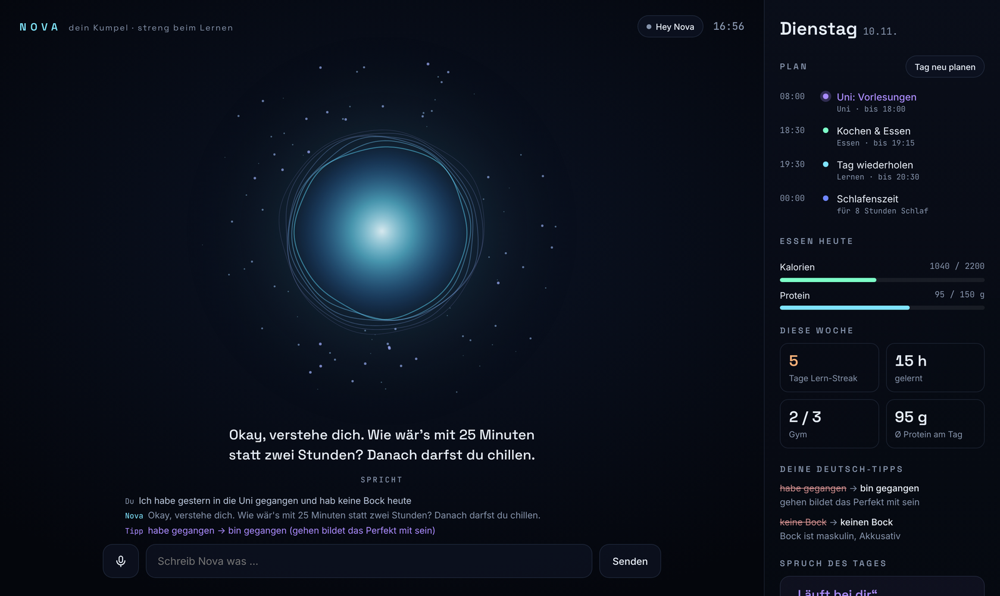
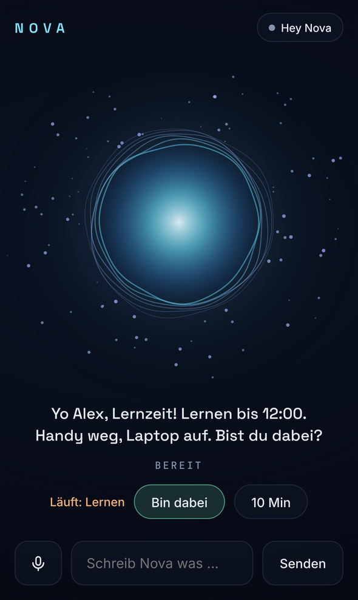
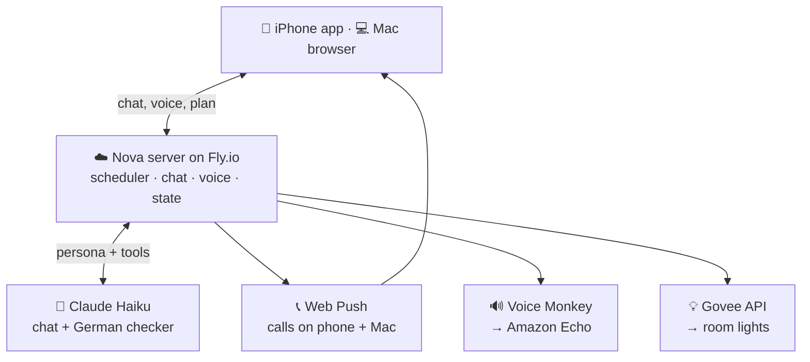

# Nova – a voice assistant that actually keeps me on track

Nova is my personal AI assistant, inspired by Iron Man's JARVIS. She talks with a realistic German voice, **calls me** when it's time to study, train, cook or sleep, keeps nagging until I confirm, corrects my German while we chat, and turns my room lights into a mood signal.

She runs 24/7 in the cloud and reaches me on my **Mac, iPhone, Amazon Echo and Govee lights** — for about **€1–3 per month**.

  

  

> Screenshots use example data. Nova speaks German because one of her jobs is helping me improve my everyday German.

---

## Why I built it

I'm a Software Engineering student who also works part-time. My problem wasn't knowing *what* to do — it was actually doing it: studying consistently, training, eating properly and getting to bed on time. Reminder apps are easy to ignore. I wanted something that feels like a friend who checks in on you and doesn't let excuses slide.

## What Nova does

| | |
|---|---|
| 📞 **Calls me** | Study blocks, gym, cooking, bedtime. If I don't answer "bin dabei", she asks again every 5 minutes (max 3×) and logs the session as skipped. |
| 🧠 **Talks like a friend** | Casual German with student slang, short spoken answers, strict about study/gym/food but understanding when I'm actually exhausted. |
| 🇩🇪 **German coach** | A separate checker reviews every message in parallel and adds one correction (e.g. *„keine Bock“ → „keinen Bock“*), ignoring speech-recognition errors and slang. Phrase of the day + role-play for real campus situations. |
| 🗓️ **Plans around real life** | Weekly schedule from config, part-time shifts added by voice ("Ich arbeite Mittwoch 6 bis 13"), day replanning when plans change ("Bin heute nicht in der Uni"). |
| 🌙 **Smart bedtime** | Computes bedtime from tomorrow's first commitment and announces it 30 min ahead. |
| 🍽️ **Meal check-ins** | Notices long gaps without food, reacts sensibly to "hab keinen Hunger". |
| 📊 **Weekly report** | Sunday summary with study hours, gym sessions, protein average and study streak — praise plus a light roast. |
| 🔊 **Amazon Echo** | Announcements play in *Nova's own voice* (custom audio via Voice Monkey), not Alexa's. |
| 💡 **Govee lights** | Lights change with Nova's mood: ice blue while she talks, red flash when she nags, warm and dim at bedtime. Voice control: "Mach das Licht lila". |
| 🎙️ **Hands-free** | "Hey Nova" wake word, push-to-talk, instant "hmm…" filler while she thinks. |

## Architecture

**How a study call reaches me:** the scheduler sees a study block starting → picks a pre-written line (no AI cost) → generates the audio → sends a Web Push to iPhone and Mac → converts the audio to 44.1 kHz and hands a public link to Voice Monkey so the Echo plays it → switches the lights to "focus" → waits for my confirmation and nags if it doesn't come.

**How a chat message works:** the browser sends text (typed or speech-recognised) → the server calls Claude Haiku with Nova's persona, my live plan as context, and tools (`replan_day`, `add_shift`, `log_meal`, `set_lights`, …) → *in parallel* a second small call checks my German → the reply goes back as text first, then audio, while the lights change colour.

## Engineering decisions

- **Claude Haiku over bigger models.** I tested Haiku vs Sonnet on real conversations. Sonnet was smarter but ~5 s per reply and ~10× the cost. For a voice assistant, speed mattered more — and better instructions fixed most of Haiku's mistakes.
- **Thinking disabled.** Measured 2.7 s → 1.7 s per reply and half the output cost, with no noticeable quality loss for short chat.
- **Prompt caching.** The persona is sent with `cache_control`, so most of each request is read from cache.
- **Templates for reminders.** Automatic calls use pre-written variations, so the AI is only paid for when I actually reply.
- **German checker as a separate call.** One small model doing two jobs kept "forgetting" the corrections; a dedicated parallel call is reliable and adds no waiting time.
- **Web app instead of native iOS app.** A free developer account can't receive push notifications, so a PWA with Web Push was the only free way to get real "calls".
- **Arabic words, real pronunciation.** Arabic-script words are synthesised as separate segments so the German voice pronounces them in Arabic (e.g. a real *ح* in "habibi").
- **Light state is restored.** Before changing colour, Nova reads each lamp's state and puts it back afterwards; redundant commands are skipped to stay under Govee's 30 req/min limit.

## Tech stack

Python (standard library HTTP server, threads) · Claude API (Haiku, tool use, prompt caching) · edge-tts · ffmpeg · Web Push (VAPID, `pywebpush`) · PWA (manifest + service worker) · Web Speech API · Canvas 2D (the orb) · Docker · Fly.io · Voice Monkey API · Govee Open API

## Costs

| Part | Per month |
|---|---|
| Claude Haiku (~50 messages/day) | ~$1–2 |
| Fly.io server (bills under $5 are waived) | $0 |
| Voice (edge-tts), speech recognition | $0 |
| Voice Monkey (200 announcements/month) | $0 |
| Govee API | $0 |

## Run it yourself

1. Copy `config.example.json` to `config.json` and fill in your name, schedule and goals.
2. **Local (Mac):** put your Anthropic key into `API_KEY.txt`, then run `./start.command` and open http://localhost:7777.
3. **Cloud:** install [flyctl](https://fly.io/docs/flyctl/), then run `./cloud-deploy.command` — it creates the app, asks for a password, and deploys.
4. Optional: `./echo-einrichten.command` (Voice Monkey token + device ID) and `./govee-einrichten.command` (Govee API key).

Secrets live in Fly secrets or local files that are git-ignored; personal data stays in `data/`, which is never committed.

## How I built it

I built Nova with **Claude (Anthropic) as an AI pair programmer**. I defined what Nova should be, made the product and cost decisions (voice tests, model comparison, hosting, phone vs native app), tested everything on my real devices and debugged the integrations (Alexa account linking, push, Govee). Claude wrote most of the implementation with me. I'm documenting this openly because building with AI tools is how I want to work — and I can explain every part of the system.

## License

MIT
